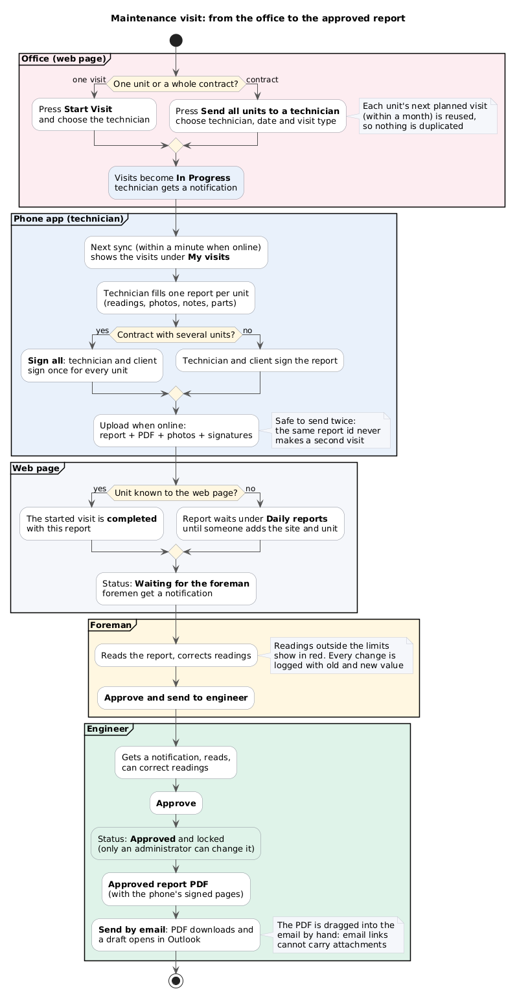
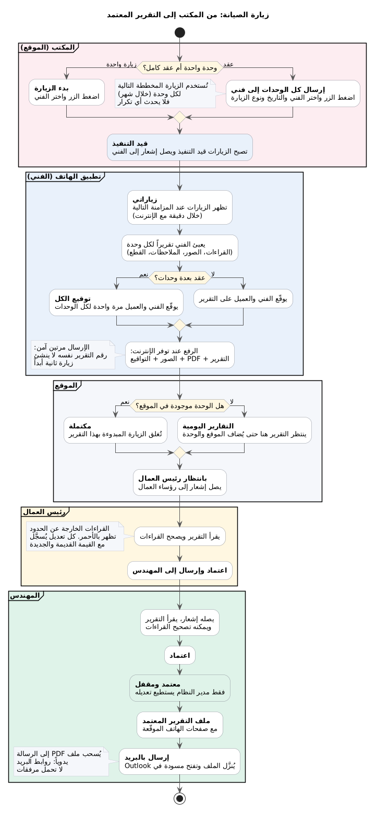

# Maintenance visit: from the office to the approved report

## What it shows

The full path of a maintenance visit through the web page and the phone app:

1. **Office (web page):** a visit is started for one unit (Start Visit), or for every unit under a contract (Send all units to a technician), and handed to a technician.
2. **Phone app:** the visits arrive under My visits at the next sync. The technician fills one report per unit; for a contract, the technician and the client sign once for all units. Reports upload when the phone is online.
3. **Web page:** a report for a known unit completes the started visit; a report for an unknown site or unit waits under Daily reports. Foremen are notified.
4. **Foreman:** reads, corrects readings (out-of-limit readings show in red, every change is logged), then approves and sends it to the engineer.
5. **Engineer:** reads, can correct, approves. The report is locked; the approved PDF includes the phone's signed pages; Send by email opens a draft in Outlook.

## Why an activity diagram

The subject is a process with decisions (one visit or a contract, unit known or not, one or several signatures) passed between people and systems. An activity diagram shows both the order and the branches. A sequence diagram would show the messages between systems but hide the decisions; a flowchart would lose the grouping by who does each step.

## Design decisions

- **Stacked sections instead of side-by-side swimlanes.** Five lanes side by side made the picture almost 2900 px wide. Each actor is a colored section instead, stacked top to bottom, so it fits a screen at 800 px wide.
- **Colors by actor:** office (pink, the brand color), phone app (blue), web page (grey), foreman (amber), engineer (green). The two status boxes that matter most, "In Progress" and "Approved", carry the color of the actor who receives them next.
- **Notes** explain the rules that are not obvious from the boxes: planned visits are reused, uploads are safe to repeat, changes are logged, and why the PDF is attached by hand.

## Assumptions

- It shows the flow as built on the web page on 17 November 2026. The phone app's My visits dashboard and Sign all step are described as the app prompt asks for them; they are not built in the app yet.
- An administrator can do any step and change an approved report; that is left out to keep the main path readable.

## Files

- `maintenance-visit-to-approved-report.puml`: the diagram source (PlantUML)
- `maintenance-visit-to-approved-report.png` and `.svg`: rendered with Kroki

## Arabic version

Same flow in Arabic: `maintenance-visit-to-approved-report-ar.puml`, `.png` and `.svg`. Each bold phrase sits on its own line, because a bold word in the middle of an Arabic line is drawn on the wrong side.
